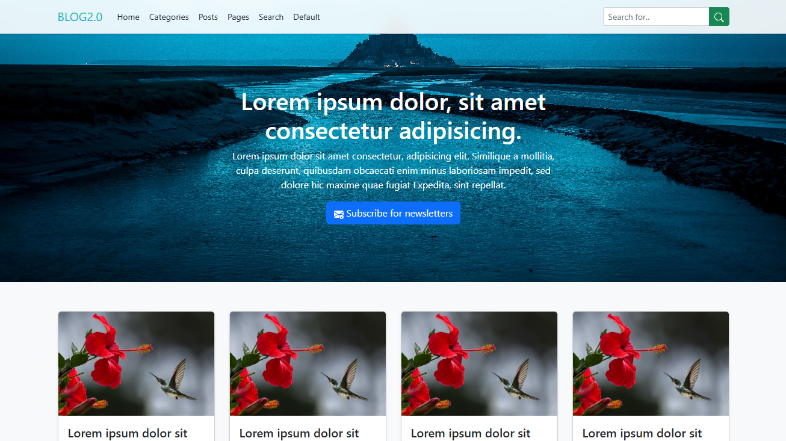
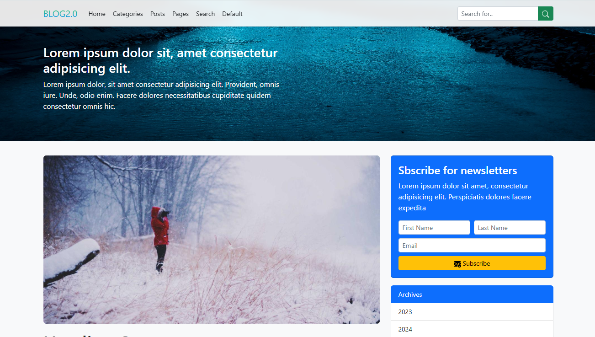
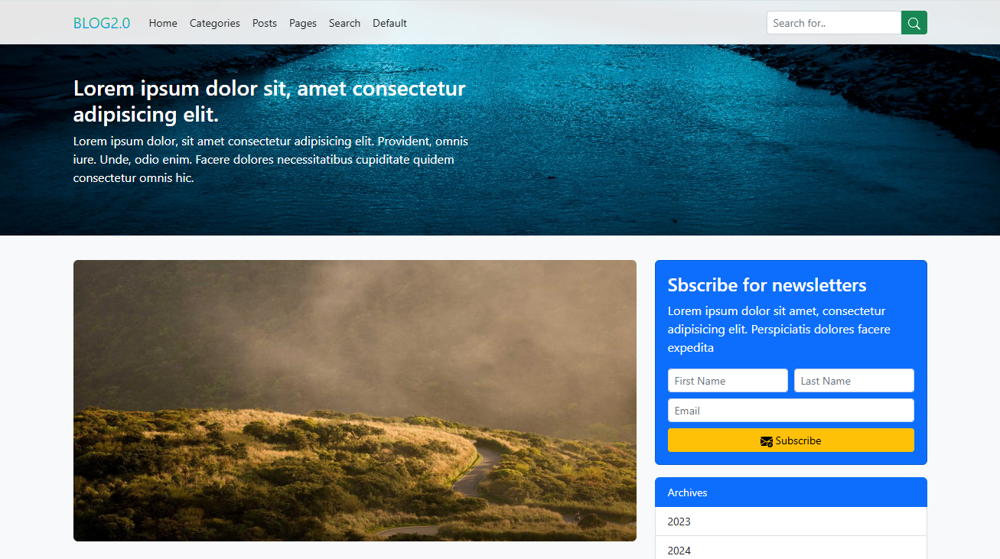
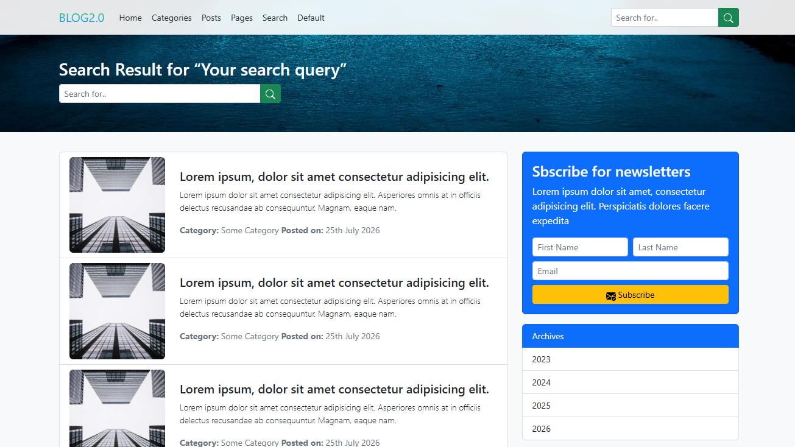

<div align="center">

# BLOG2.0

### Responsive Multi-Page Blog Website

A Bootstrap 5-based blog website interface featuring a homepage, post layouts, content pages, category sections, search results, and newsletter subscription UI.

<p>
  
  
  
  
</p>

<p>
  <a href="https://blog-app-mhsakibb.vercel.app/"><strong>Live Demo</strong></a>
  &nbsp; | &nbsp;
  <a href="https://github.com/mhsakibb/Ultimate-Bootstrap/tree/main/Blog%20App"><strong>Source Code</strong></a>
  &nbsp; | &nbsp;
  <a href="https://github.com/mhsakibb/Ultimate-Bootstrap"><strong>Main Repository</strong></a>
</p>

</div>

---

## Table of Contents

<details>
<summary><strong>Expand Table of Contents</strong></summary>

- [Project Overview](#project-overview)
- [Project Highlights](#project-highlights)
- [Technologies Used](#technologies-used)
- [Key Features](#key-features)
- [Website Pages](#website-pages)
  - [Homepage](#1-homepage)
  - [Default and Category Layout](#2-default-and-category-layout)
  - [Posts and Article Layout](#3-posts-and-article-layout)
  - [Content Page](#4-content-page)
  - [Search Results Page](#5-search-results-page)
- [Project Screenshots](#project-screenshots)
- [Project Structure](#project-structure)
- [Getting Started](#getting-started)
- [Running the Project Locally](#running-the-project-locally)
- [UI Components and Implementation](#ui-components-and-implementation)
- [Current Scope and Limitations](#current-scope-and-limitations)
- [Possible Enhancements](#possible-enhancements)
- [Author](#author)

</details>

---

## Project Overview

**BLOG2.0** is a responsive, multi-page blog website interface developed using HTML5, CSS3, and Bootstrap 5.

The project demonstrates how to structure a blog website with different content layouts, reusable navigation, article presentation, search result interfaces, and newsletter subscription sections.

It includes five interconnected HTML pages, each representing a different part of a typical blog website.

The design uses Bootstrap's responsive grid system and prebuilt components to organize content into clean layouts. Custom CSS adds visual enhancements such as gradient branding, background images, and a blurred navigation effect.

This project is part of my practical Bootstrap learning journey, focusing on building structured and responsive website interfaces.

## Project Highlights

| Category | Details |
|---|---|
| Project Name | BLOG2.0 |
| Project Type | Multi-Page Blog Website |
| Application Type | Front-End Web Interface |
| Main Framework | Bootstrap 5 |
| Bootstrap Version | 5.2.0-beta1 |
| Markup | HTML5 |
| Styling | CSS3 |
| Number of Pages | 5 |
| Custom Stylesheet | `style.css` |
| Local Image Assets | 2 |
| Responsive Layout | Yes |
| Hosting Platform | Vercel |

## Technologies Used

The project is built using the following technologies:

| Technology | Purpose |
|---|---|
| HTML5 | Defines the structure and content of the website |
| CSS3 | Provides custom styling and visual enhancements |
| Bootstrap 5 | Provides responsive layouts, components, and utility classes |
| Bootstrap JavaScript Bundle | Handles interactive Bootstrap components |
| Inline SVG | Provides interface icons |
| Vercel | Hosts the deployed website |
| Git & GitHub | Source code management and version control |

### Bootstrap Components and Concepts

The project demonstrates practical use of:

- Responsive grid system and containers.
- Fixed and collapsible navigation bars.
- Cards and card layouts.
- List groups.
- Forms and input groups.
- Buttons and button styles.
- Modal dialogs.
- Responsive images.
- Spacing and display utilities.
- Text and background utility classes.

## Key Features

### Multi-Page Blog Structure

- Dedicated homepage for blog content.
- Default and category-style content layout.
- Post and article presentation layout.
- General content page template.
- Search results page interface.

### Navigation and Layout

- Responsive navigation bar.
- Collapsible navigation menu for smaller screens.
- Consistent navigation across all pages.
- Fixed navigation with a blurred background effect.
- Bootstrap-based responsive content sections.

### Blog Content Presentation

- Blog post cards with images.
- Post title and description sections.
- Category and publication metadata.
- Article-style content with multiple heading levels.
- Archive and category sidebar sections.

### Newsletter Subscription Interface

- Newsletter subscription section.
- Subscription modal on the homepage.
- First name, last name, and email input fields.
- Bootstrap modal-based presentation.

### Custom Styling

- Gradient text branding.
- Background banner image.
- Custom navigation styling.
- Responsive image presentation.
- Additional CSS enhancements using a separate stylesheet.

## Website Pages

The website contains five HTML pages connected through a shared navigation structure.

### 1. Homepage

**File:** [`index.html`](./index.html)

The homepage acts as the main entry point of BLOG2.0. It presents the blog introduction and a collection of blog post cards.

**Features:**

- BLOG2.0 brand navigation.
- Responsive fixed navigation bar.
- Hero section with introductory content.
- Blog post cards with images.
- Post title and preview content.
- Read More buttons.
- Newsletter subscription button.
- Bootstrap newsletter subscription modal.

**Newsletter Modal Fields:**

- First Name
- Last Name
- Email Address

### 2. Default and Category Layout

**File:** [`default.html`](./default.html)

This page demonstrates a default blog content layout with post previews and supporting sidebar sections.

**Features:**

- Responsive navigation bar.
- Main content section with blog post previews.
- Image-based post listing.
- Post title and description.
- Category and publication information.
- Archive list.
- Category list.
- Newsletter subscription section.

The page demonstrates how blog posts and supporting content can be arranged using Bootstrap's grid and list-group components.

### 3. Posts and Article Layout

**File:** [`posts.html`](./posts.html)

This page demonstrates a blog article layout with structured content and a comment interface.

**Features:**

- Main article content section.
- Multiple heading levels.
- Article image.
- Structured text presentation.
- Post your thoughts section.
- Comment form interface.
- Archive and category sidebar.
- Newsletter subscription section.

**Comment Form Fields:**

- First Name
- Last Name
- Email Address
- Comment

### 4. Content Page

**File:** [`page.html`](./page.html)

This page demonstrates a general content-page layout that can be used for displaying static website information or additional blog content.

**Features:**

- Shared responsive navigation.
- Main content section.
- Responsive image presentation.
- Multiple heading levels.
- Structured text content.
- Newsletter subscription section.
- Archive list.
- Category list.

### 5. Search Results Page

**File:** [`search.html`](./search.html)

This page demonstrates how search results can be presented within a blog website.

**Features:**

- Search results heading.
- Search input interface.
- Search button.
- Search result list.
- Image-based result entries.
- Result title and description.
- Archive and category sidebar.
- Newsletter subscription section.

The page currently displays sample search-result content as a front-end layout.

---

## Project Screenshots

The following screenshots show the main interfaces of BLOG2.0.

### 1. Homepage

<p align="center">
  <a href="../screenshots/blog-homepage.png">
    
  </a>
</p>

### 2. Blog Posts

<p align="center">
  <a href="../screenshots/blog-posts.png">
    
  </a>
</p>

### 3. Article Page

<p align="center">
  <a href="../screenshots/blog-article.png">
    
  </a>
</p>

### 4. Search Results

<p align="center">
  <a href="../screenshots/blog-search.png">
    
  </a>
</p>

---

## Project Structure

<details>
<summary><strong>Expand Project Structure</strong></summary>

The project is organized into HTML pages, a custom CSS stylesheet, and a local image directory.

**Main project files:**

<ul>
  <li>
    <a href="./index.html"><strong>index.html</strong></a>
    <ul>
      <li>Homepage and featured blog content.</li>
      <li>Newsletter subscription modal.</li>
    </ul>
  </li>
  <li>
    <a href="./default.html"><strong>default.html</strong></a>
    <ul>
      <li>Default blog layout and category-style content.</li>
      <li>Post previews, archives, and category sections.</li>
    </ul>
  </li>
  <li>
    <a href="./posts.html"><strong>posts.html</strong></a>
    <ul>
      <li>Post and article content layout.</li>
      <li>Comment form interface.</li>
    </ul>
  </li>
  <li>
    <a href="./page.html"><strong>page.html</strong></a>
    <ul>
      <li>General content-page layout.</li>
    </ul>
  </li>
  <li>
    <a href="./search.html"><strong>search.html</strong></a>
    <ul>
      <li>Search results interface.</li>
    </ul>
  </li>
  <li>
    <a href="./style.css"><strong>style.css</strong></a>
    <ul>
      <li>Custom branding, banner, and navigation styles.</li>
    </ul>
  </li>
  <li>
    <a href="./img/"><strong>img/</strong></a>
    <ul>
      <li><a href="./img/banner.jpg">banner.jpg</a> — Main background banner image.</li>
      <li><a href="./img/post-image.jpg">post-image.jpg</a> — Blog post image asset.</li>
    </ul>
  </li>
  <li>
    <strong>README.md</strong>
    <ul>
      <li>Project documentation.</li>
    </ul>
  </li>
</ul>

**Screenshot files in the parent repository:**

<ul>
  <li><a href="../screenshots/blog-homepage.png">blog-homepage.png</a> — Homepage screenshot.</li>
  <li><a href="../screenshots/blog-posts.png">blog-posts.png</a> — Posts page screenshot.</li>
  <li><a href="../screenshots/blog-article.png">blog-article.png</a> — Article page screenshot.</li>
  <li><a href="../screenshots/blog-search.png">blog-search.png</a> — Search results screenshot.</li>
</ul>

</details>

## Getting Started

Follow the instructions below to run BLOG2.0 on your local machine.

### Prerequisites

Before running the project, make sure you have:

- A modern web browser such as Google Chrome, Microsoft Edge, or Firefox.
- Visual Studio Code or another code editor.
- An active internet connection to load Bootstrap and externally hosted images.

No Node.js installation, package manager, or build tool is required.

### Clone the Repository

Open your terminal and execute:

```bash
git clone https://github.com/mhsakibb/Ultimate-Bootstrap.git
```

Navigate to the repository:

```bash
cd Ultimate-Bootstrap
```

Open the project directory:

```text
Blog App/
```

## Running the Project Locally

### Option 1: Using Visual Studio Code Live Server

1. Open the `Ultimate-Bootstrap` repository in Visual Studio Code.
2. Navigate to the `Blog App` folder.
3. Open `index.html`.
4. Right-click inside the editor.
5. Select **Open with Live Server**.
6. The BLOG2.0 homepage will open in your default browser.

You can navigate between the other pages using the website navigation bar.

### Option 2: Opening Directly in a Browser

1. Open the `Blog App` folder.
2. Locate `index.html`.
3. Double-click the file.
4. The homepage will open in your browser.

**Recommended:** Use the Live Server extension in Visual Studio Code during development.

## UI Components and Implementation

This project applies Bootstrap components and custom CSS to build a consistent multi-page website.

| Component / Concept | Implementation |
|---|---|
| Navbar | Shared navigation across all five pages |
| Navbar Collapse | Responsive navigation for smaller screens |
| Grid System | Main content and sidebar layouts |
| Cards | Homepage blog post previews |
| List Groups | Archive, category, and search result sections |
| Forms | Search, newsletter, and comment interfaces |
| Modal | Homepage newsletter subscription |
| Images | Local blog images and externally hosted sample images |
| Custom CSS | Gradient branding, background banner, and blurred navbar |

### Custom CSS

The [`style.css`](./style.css) file contains the project's custom visual styling.

Some of the key custom styles include:

- `.brand-gradient` — Gradient text effect for the BLOG2.0 brand.
- `.banner-holder` — Background banner styling.
- `.main-page-header` — Header background image styling.
- `.custom-nav` — Blurred navigation background effect.

The Bootstrap CSS and JavaScript Bundle are loaded through the jsDelivr CDN.

## Current Scope and Limitations

BLOG2.0 is currently a **front-end website interface project**. It demonstrates page structure, content organization, responsive design, and Bootstrap components.

It does not currently include a backend, database, or content management system.

The following limitations apply:

- **Blog Content:** Post titles, descriptions, and other content are static sample content.
- **Search Functionality:** The search interface and results layout are present, but there is no dynamic search engine or filtering logic.
- **Newsletter Subscription:** The newsletter form is a UI demonstration and does not store subscriber information.
- **Comment Submission:** The comment form is not connected to a backend or database.
- **Post Navigation:** Some post links and buttons use placeholder destinations.
- **Categories and Archives:** These sections demonstrate the layout; their links do not implement dynamic filtering.
- **Content Management:** There is no admin panel for creating, updating, or deleting blog posts.

Bootstrap-powered navigation collapse and the homepage subscription modal work on the client side through the Bootstrap JavaScript Bundle.

## Possible Enhancements

The project could be extended into a complete blog platform through the following improvements:

- Integrate a backend using Node.js, PHP, Python, or another server-side technology.
- Connect a database such as MySQL, PostgreSQL, or MongoDB.
- Implement dynamic blog post creation and management.
- Develop a working search and filtering system.
- Add functional category and archive navigation.
- Implement user comments and comment moderation.
- Connect newsletter subscriptions to a database or email service.
- Add pagination for blog posts and search results.
- Introduce an admin dashboard and authentication system.
- Improve accessibility, SEO, and performance.

## Author

<div align="center">

**MH Sakib**

Computer Science and Engineering Student | Front-End Development Enthusiast

[GitHub](https://github.com/mhsakibb) · [LinkedIn](https://www.linkedin.com/in/mhsakibb/)

</div>

---

<div align="center">

**BLOG2.0 — Responsive Multi-Page Blog Website**

Built as a practical Bootstrap 5 front-end project.

</div>