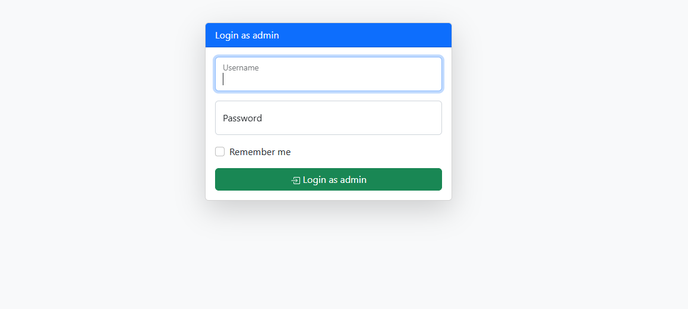
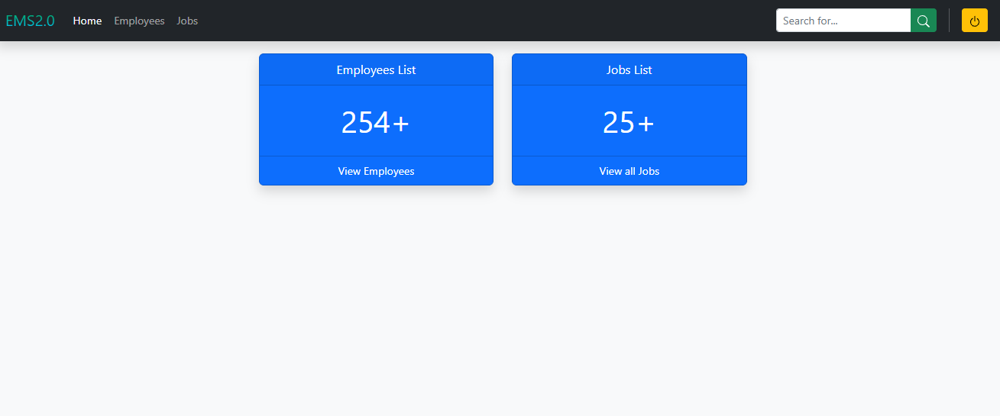
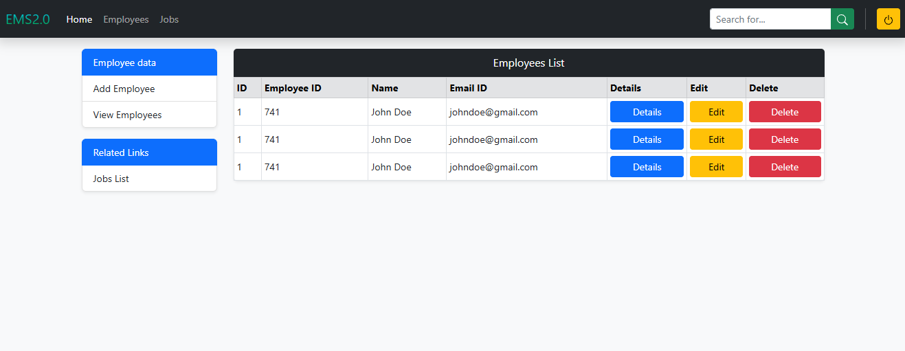
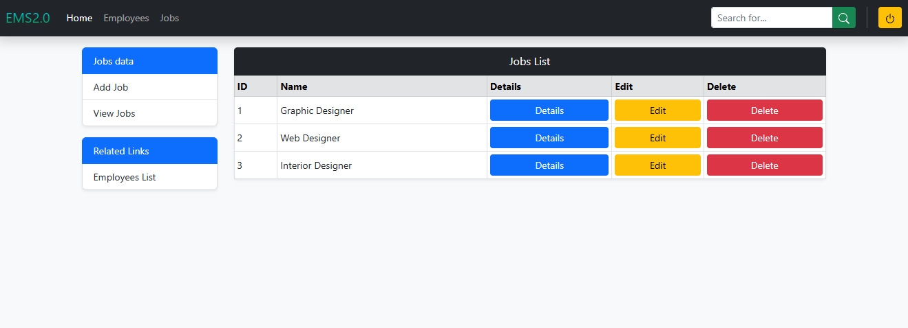

<div align="center">

# Employee Management System

### EMS 2.0 — Bootstrap-Based Administrative Dashboard

A responsive front-end interface for managing employee information and job listings, built with HTML5 and Bootstrap 5.

<p>
  
  
  
  
</p>

<p>
  <a href="https://ems-website-blond.vercel.app/"><strong>Live Demo</strong></a>
  &nbsp; | &nbsp;
  <a href="https://github.com/mhsakibb/Ultimate-Bootstrap/tree/main/EMS%20Website"><strong>Source Code</strong></a>
  &nbsp; | &nbsp;
  <a href="https://github.com/mhsakibb/Ultimate-Bootstrap"><strong>Main Repository</strong></a>
</p>

</div>

---

## Table of Contents

<details>
<summary><strong>Expand Table of Contents</strong></summary>

- [Project Overview](#project-overview)
- [Project Highlights](#project-highlights)
- [Technologies Used](#technologies-used)
- [Key Features](#key-features)
- [Website Pages](#website-pages)
  - [Admin Login Page](#1-admin-login-page)
  - [Dashboard](#2-dashboard)
  - [Employee Management](#3-employee-management)
  - [Job Management](#4-job-management)
- [Project Screenshots](#project-screenshots)
- [Project Structure](#project-structure)
- [Getting Started](#getting-started)
- [Running the Project Locally](#running-the-project-locally)
- [Interface Interactions](#interface-interactions)
- [Current Scope and Limitations](#current-scope-and-limitations)
- [Possible Enhancements](#possible-enhancements)
- [Author](#author)

</details>

---

## Project Overview

**Employee Management System (EMS 2.0)** is a Bootstrap-based administrative dashboard interface designed to demonstrate how an employee and job management system can be organized through a clean, responsive web interface.

The project provides a simple administrative layout where users can navigate between a dashboard, employee records, and job listings. It uses Bootstrap components such as navigation bars, responsive grids, tables, forms, cards, and modal dialogs to create an organized management experience.

The interface contains four main pages:

- An administrative login screen.
- A dashboard showing employee and job summaries.
- An employee management page with a structured employee table.
- A job management page with a structured job listing.

This project is part of my Bootstrap learning journey and focuses on practical front-end interface development.

## Project Highlights

| Category | Details |
|---|---|
| Project Name | Employee Management System |
| Interface Version | EMS 2.0 |
| Project Type | Front-End Web Application |
| Main Purpose | Employee and Job Management Interface |
| Core Technologies | HTML5, CSS3, Bootstrap 5 |
| Bootstrap Version | 5.2.0-beta1 |
| Number of Pages | 4 |
| Responsive Layout | Yes |
| UI Components | Cards, Tables, Forms, Modals, Navbar |
| Hosting Platform | Vercel |

## Technologies Used

The project uses the following technologies and tools:

| Technology | Purpose |
|---|---|
| HTML5 | Website structure and content |
| CSS3 | Styling and visual customization |
| Bootstrap 5 | Responsive layout, components, and utility classes |
| Bootstrap JavaScript Bundle | Navbar collapse and modal interactions |
| Inline SVG | Interface icons |
| Vercel | Deployment and hosting |

### Bootstrap Components Practiced

- Responsive grid system
- Navigation bar and collapsible navigation
- Cards and card layouts
- Tables
- Form controls and floating labels
- Input groups
- List groups
- Modal dialogs
- Buttons and utility classes
- Responsive spacing and alignment

## Key Features

### Administrative Interface

- Simple admin login screen.
- Dashboard with employee and job summary cards.
- Navigation between dashboard, employees, and jobs.
- Consistent navigation and interface styling across pages.

### Employee Management Interface

- Employee information displayed in a structured table.
- Add employee modal with input fields.
- Employee details modal.
- Edit employee information modal.
- Delete confirmation modal.

### Job Management Interface

- Job listings displayed in a structured table.
- Add job modal.
- Job details modal.
- Edit job information modal.
- Delete confirmation modal.

### Responsive Design

- Bootstrap responsive grid layout.
- Collapsible navigation on smaller screens.
- Responsive forms, tables, cards, and modal layouts.
- Consistent spacing and alignment.

## Website Pages

The application is divided into four HTML pages, each serving a specific purpose.

### 1. Admin Login Page

**File:** [`index.html`](./index.html)

The login page provides the initial entry point to the administrative interface.

**Features:**

- Admin login form.
- Username input field.
- Password input field.
- Remember me checkbox.
- Login button.
- Bootstrap card layout with a centered form.

The login form navigates to the dashboard page using an HTML form action.

### 2. Dashboard

**File:** [`dash.html`](./dash.html)

The dashboard provides an overview of the employee and job sections.

**Features:**

- EMS 2.0 branding.
- Responsive navigation bar.
- Navigation links to Home, Employees, and Jobs.
- Search input interface.
- Employee summary card showing `254+`.
- Job summary card showing `25+`.
- Navigation link to the employee listing.
- Navigation link to the job listing.
- Logout navigation back to the login page.

### 3. Employee Management

**File:** [`employees-list.html`](./employees-list.html)

The employee management page provides a table-based interface for viewing and organizing employee information.

**Features:**

- Employee listing table.
- Employee ID and personal information columns.
- Employee details modal.
- Add employee modal.
- Edit employee modal.
- Delete confirmation modal.
- Job assignment selection.
- Related navigation to the jobs section.

**Employee Information Fields:**

- Joining date
- First name
- Last name
- Email address
- Phone number
- Assigned job

### 4. Job Management

**File:** [`jobs-list.html`](./jobs-list.html)

The job management page provides an interface for viewing and organizing job positions.

**Features:**

- Job listing table.
- Job ID and job name.
- Add job modal.
- Job details modal.
- Edit job modal.
- Delete confirmation modal.
- Related navigation to the employee section.

**Job Information Fields:**

- Job creation date
- Job name

---

## Project Screenshots

The following screenshots demonstrate the different pages and interfaces of the Employee Management System.

### 1. Admin Login Page

<p align="center">
  <a href="../screenshots/ems-login.png">
    
  </a>
</p>

### 2. Dashboard

<p align="center">
  <a href="../screenshots/ems-dashboard.png">
    
  </a>
</p>

### 3. Employee Management

<p align="center">
  <a href="../screenshots/ems-employees.png">
    
  </a>
</p>

### 4. Job Management

<p align="center">
  <a href="../screenshots/ems-jobs.png">
    
  </a>
</p>

---

## Project Structure

<details>
<summary><strong>Expand Project Structure</strong></summary>

The project contains four HTML pages. The screenshots are maintained separately in the parent repository's `screenshots` directory.

**Project files:**

<ul>
  <li>
    <a href="./index.html"><strong>index.html</strong></a>
    <ul>
      <li>Admin login interface.</li>
    </ul>
  </li>
  <li>
    <a href="./dash.html"><strong>dash.html</strong></a>
    <ul>
      <li>Administrative dashboard and summary cards.</li>
    </ul>
  </li>
  <li>
    <a href="./employees-list.html"><strong>employees-list.html</strong></a>
    <ul>
      <li>Employee table and employee management modals.</li>
    </ul>
  </li>
  <li>
    <a href="./jobs-list.html"><strong>jobs-list.html</strong></a>
    <ul>
      <li>Job listing table and job management modals.</li>
    </ul>
  </li>
  <li>
    <a href="./README.md"><strong>README.md</strong></a>
    <ul>
      <li>Project documentation.</li>
    </ul>
  </li>
</ul>

**Screenshot files:**

<ul>
  <li><a href="../screenshots/ems-login.png">ems-login.png</a> — Login page screenshot</li>
  <li><a href="../screenshots/ems-dashboard.png">ems-dashboard.png</a> — Dashboard screenshot</li>
  <li><a href="../screenshots/ems-employees.png">ems-employees.png</a> — Employee management screenshot</li>
  <li><a href="../screenshots/ems-jobs.png">ems-jobs.png</a> — Job management screenshot</li>
</ul>

</details>

## Getting Started

Follow these instructions to get a local copy of the project running on your computer.

### Prerequisites

Before running the project, make sure you have:

- A modern web browser such as Google Chrome, Microsoft Edge, or Firefox.
- Visual Studio Code or another code editor.
- An active internet connection to load Bootstrap resources from the CDN.

No Node.js installation, package manager, or build tool is required.

### Clone the Repository

Open your terminal and run:

```bash
git clone https://github.com/mhsakibb/Ultimate-Bootstrap.git
```

Navigate to the repository:

```bash
cd Ultimate-Bootstrap
```

Open the project folder:

```text
EMS Website/
```

## Running the Project Locally

### Option 1: Using Visual Studio Code Live Server

1. Open the `Ultimate-Bootstrap` repository in Visual Studio Code.
2. Navigate to the `EMS Website` folder.
3. Open `index.html`.
4. Right-click inside the editor.
5. Select **Open with Live Server**.
6. The login page will open in your default browser.

### Option 2: Opening Directly in a Browser

1. Navigate to the `EMS Website` folder.
2. Locate `index.html`.
3. Double-click the file.
4. The login interface will open in your browser.

**Recommended:** Use the Live Server extension in Visual Studio Code for a smoother local development experience.

## Interface Interactions

The following table describes the interactions available in the current front-end implementation.

| Interface Element | Expected Interaction |
|---|---|
| Login button | Navigates to the dashboard |
| Home navigation | Opens the dashboard |
| Employees navigation | Opens the employee listing |
| Jobs navigation | Opens the job listing |
| Add Employee | Opens the employee form modal |
| Employee Details | Opens the employee details modal |
| Edit Employee | Opens the employee edit modal |
| Delete Employee | Opens the delete confirmation modal |
| Add Job | Opens the job form modal |
| Job Details | Opens the job details modal |
| Edit Job | Opens the job edit modal |
| Delete Job | Opens the delete confirmation modal |
| Logout button | Returns to the login page |

## Current Scope and Limitations

This project currently focuses on the **front-end interface and Bootstrap component implementation**. It does not include a backend or database.

The following limitations should be considered:

- **Authentication:** The login form navigates to the dashboard but does not validate usernames or passwords.
- **Database:** Employee and job information is displayed using static sample data.
- **CRUD Operations:** Add, edit, and delete interfaces are provided through modals, but the changes are not saved to a database.
- **Search:** Search fields are present as interface elements but do not implement actual filtering.
- **Dashboard Statistics:** The displayed employee and job counts are hard-coded sample values.
- **Form Processing:** Forms are not connected to a server or API.

Bootstrap-powered navigation collapse and modal interactions work on the client side through the Bootstrap JavaScript Bundle.

This is a front-end demonstration project, not a production-ready employee management system.

## Possible Enhancements

The project can be extended into a complete employee management application through the following improvements:

- Implement secure admin authentication and authorization.
- Integrate a backend using PHP, Node.js, Python, or another server-side technology.
- Connect a database such as MySQL, PostgreSQL, or MongoDB.
- Implement complete employee CRUD operations.
- Implement complete job CRUD operations.
- Add working search, filtering, and sorting functionality.
- Introduce form validation and meaningful success or error messages.
- Make dashboard statistics dynamic.
- Add pagination for large employee and job datasets.
- Improve application security and access control.

## Author

<div align="center">

**MH Sakib**

Computer Science and Engineering Student | Front-End Development Enthusiast

[GitHub](https://github.com/mhsakibb) · [LinkedIn](https://www.linkedin.com/in/mhsakibb/)

</div>

---

<div align="center">

**Employee Management System — EMS 2.0**

Built as a practical Bootstrap 5 front-end project.

</div>