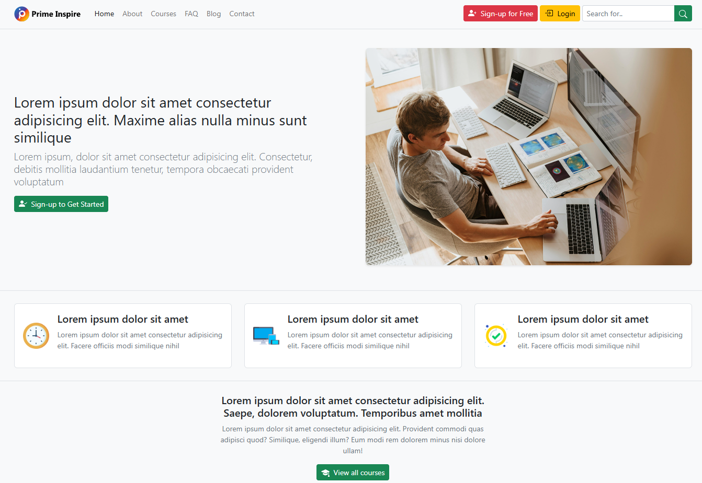
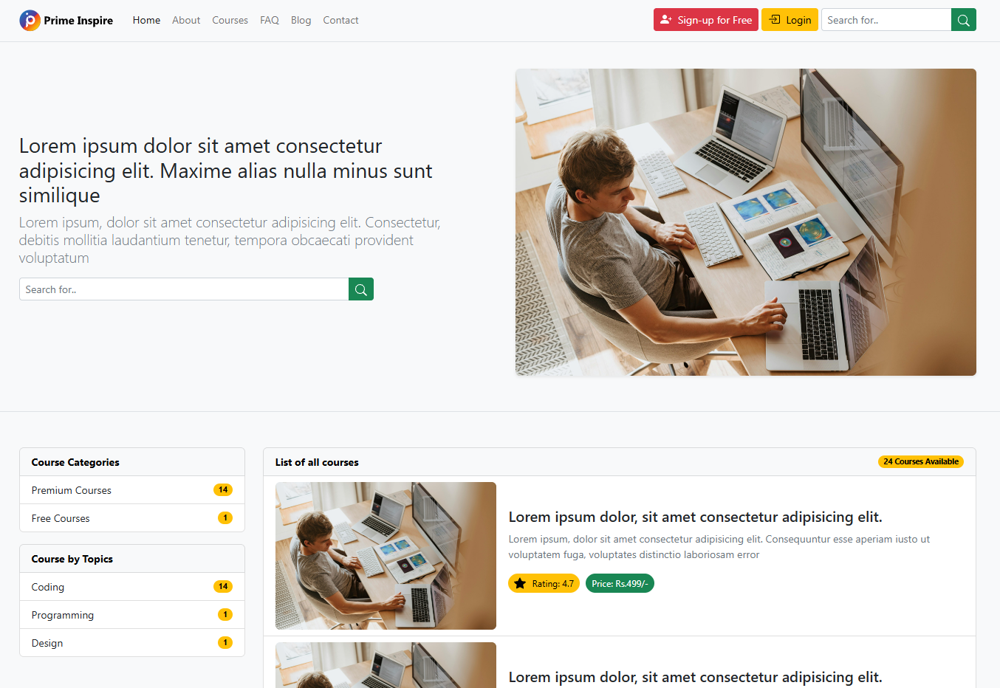
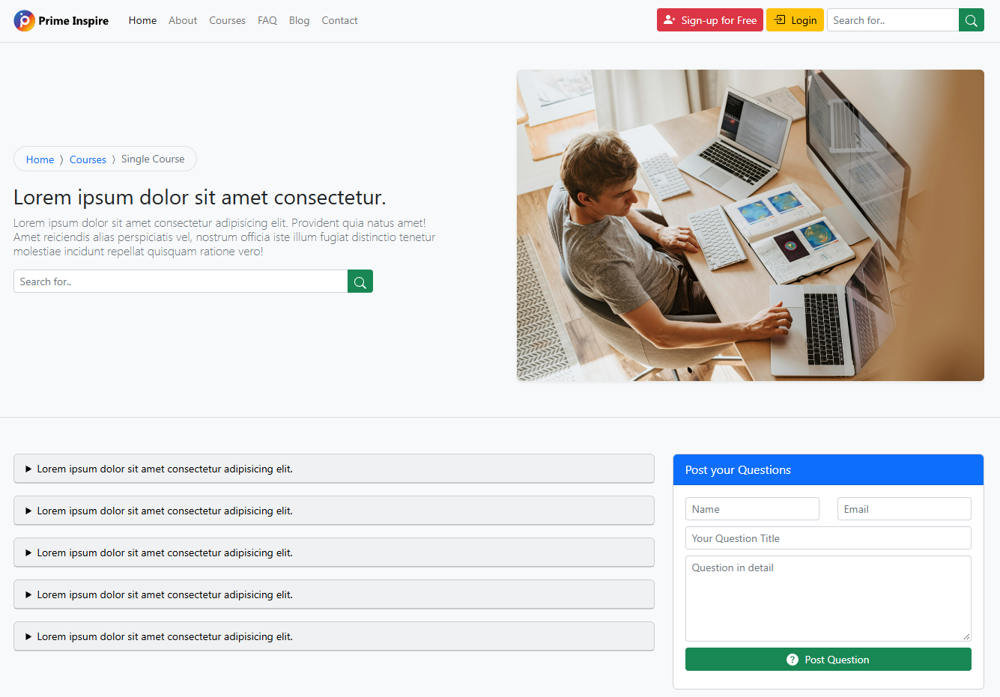
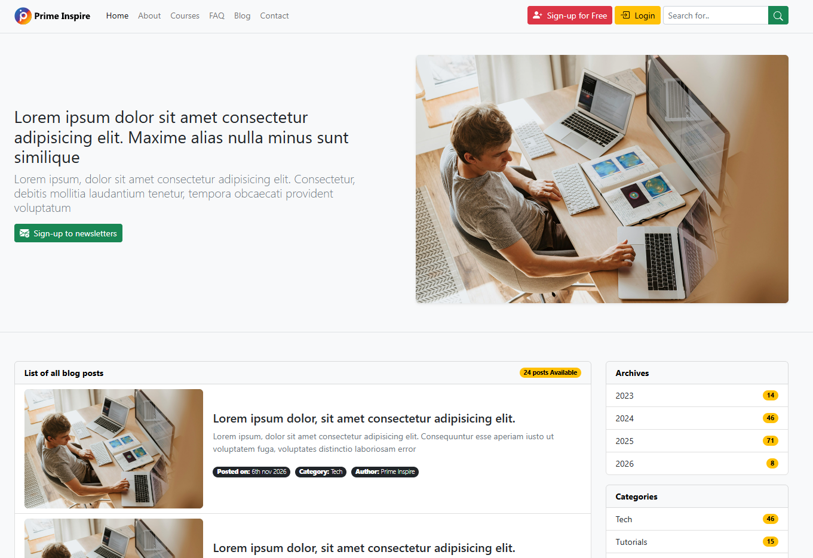
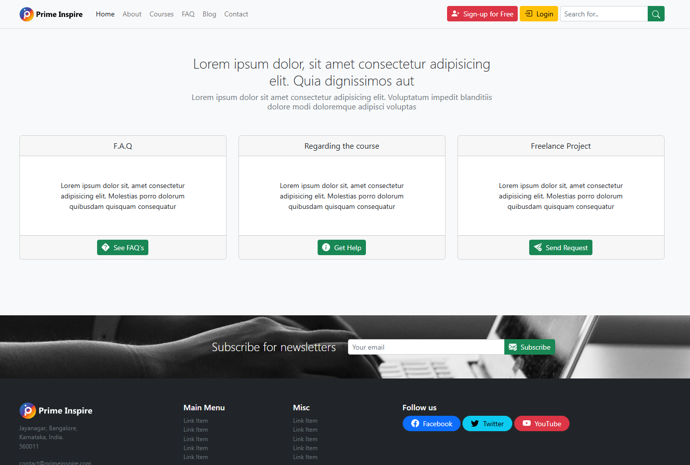

<div align="center">

# Real World Education App

### Prime Inspire — Responsive Multi-Page Educational Website

A Bootstrap-based educational website interface featuring course discovery, individual course details, an FAQ section, a blog, and contact facilities. Built with HTML5, CSS3, and Bootstrap 5.

<br>


<br>

<a href="https://real-world-education-app.vercel.app/">
  
</a>

<a href="https://github.com/mhsakibb/Ultimate-Bootstrap/tree/main/Real%20World%20Education%20app">
  
</a>

</div>

---

## Table of Contents

<details>
<summary><strong>Click to Expand / Collapse Table of Contents</strong></summary>

- [Project Overview](#project-overview)
- [Live Demo](#live-demo)
- [Project Highlights](#project-highlights)
- [Tech Stack](#tech-stack)
- [Key Features](#key-features)
- [Website Pages](#website-pages)
  - [1. Homepage](#1-homepage)
  - [2. About Page](#2-about-page)
  - [3. Courses Page](#3-courses-page)
  - [4. Single Course Page](#4-single-course-page)
  - [5. FAQ Page](#5-faq-page)
  - [6. Blog Page](#6-blog-page)
  - [7. Single Post Page](#7-single-post-page)
  - [8. Contact Page](#8-contact-page)
- [Project Screenshots](#project-screenshots)
- [Project Structure](#project-structure)
- [Getting Started](#getting-started)
- [Running the Project Locally](#running-the-project-locally)
- [Implementation Details](#implementation-details)
- [Learning Outcomes](#learning-outcomes)
- [Future Improvements](#future-improvements)
- [Author](#author)

</details>

---

## Project Overview

**Real World Education App** is a multi-page educational website interface developed under the brand name **Prime Inspire**.

The project focuses on creating a structured and responsive website for an online learning platform. It provides dedicated interfaces for presenting educational information, browsing courses, viewing individual course details, exploring educational articles, finding answers to common questions, and contacting the platform.

The website is developed using Bootstrap 5 and custom CSS, with an emphasis on responsive layouts, reusable interface components, and consistent page navigation.

This project is part of my Bootstrap learning journey, where I applied the framework's layout system, components, forms, spacing utilities, and responsive features to a practical multi-page website.

## Live Demo

<badge-placeholder></badge-placeholder>

**Live Website:** [https://real-world-education-app.vercel.app/](https://real-world-education-app.vercel.app/)

**GitHub Repository:** [Ultimate Bootstrap](https://github.com/mhsakibb/Ultimate-Bootstrap)

**Project Directory:** [Real World Education App](https://github.com/mhsakibb/Ultimate-Bootstrap/tree/main/Real%20World%20Education%20app)

---

## Project Highlights

| Category | Details |
|---|---|
| Project Name | Real World Education App |
| Brand | Prime Inspire |
| Project Type | Educational Website Interface |
| Website Structure | Multi-Page Website |
| Front-End Framework | Bootstrap 5 |
| Markup | HTML5 |
| Styling | CSS3 |
| Interactivity | Bootstrap JavaScript Bundle |
| Deployment | Vercel |
| Version Control | Git and GitHub |

---

## Tech Stack

| Technology | Usage |
|---|---|
| HTML5 | Structuring website pages and content |
| CSS3 | Custom styling and visual enhancements |
| Bootstrap 5 | Responsive layouts, grid system, forms, and components |
| Bootstrap JavaScript Bundle | Collapsible navigation and modal interactions |
| SVG Icons | Interface icons and visual indicators |
| Google Fonts | Typography |
| Vercel | Website deployment and hosting |
| Git & GitHub | Version control and source code management |

**Bootstrap Version:** 5.2.0-beta1

Bootstrap CSS and JavaScript are included through jsDelivr CDN links.

---

## Key Features

### 1. Multi-Page Website Architecture

The project contains eight separate HTML pages connected through a common navigation structure.

- Homepage
- About
- Courses
- Single Course
- FAQ
- Blog
- Single Post
- Contact

### 2. Responsive Navigation

- Consistent navigation across the website.
- Collapsible navigation menu for smaller screens.
- Internal page navigation.
- Search input interface.
- Sign-up and login interface links.

### 3. Educational Content Presentation

- Educational platform introduction.
- Course categories and listings.
- Individual course information.
- Course pricing and ratings.
- Course description and content sections.
- Blog and article presentation.

### 4. Bootstrap-Based UI Components

- Responsive grid layouts.
- Navigation components.
- Form controls and input groups.
- Buttons and badges.
- Cards and content sections.
- Bootstrap modals.
- Breadcrumb navigation.
- Spacing and alignment utilities.

### 5. Contact and Subscription Interfaces

- FAQ and help sections.
- Contact form modal.
- Newsletter subscription interface.
- Email input fields.
- Structured contact information.

### 6. Consistent Design

- Reusable navigation and footer layouts.
- Consistent branding and logo assets.
- Custom CSS enhancements.
- Responsive images.
- Gradient and background styling.
- Visual hierarchy across different website pages.

---

## Website Pages

### 1. Homepage

**File:** `index.html`

The homepage serves as the main landing page of the educational platform. It introduces the website and provides visitors with entry points to explore courses and other educational resources.

**Key Features:**

- Main hero section.
- Educational platform introduction.
- Sign-up call-to-action interface.
- Featured content and promotional sections.
- Course category overview.
- Premium and free course summaries.
- Course topics such as Coding, Programming, and Design.
- Course listing with ratings and prices.
- Newsletter subscription section.
- Shared navigation and footer.

**Screenshot**

<p align="center">
  
</p>

<p align="center">
  <em>Prime Inspire — Homepage</em>
</p>

---

### 2. About Page

**File:** `about.html`

The About page introduces Prime Inspire and provides information about the educational platform.

**Key Features:**

- Platform introduction.
- Welcome section.
- Educational platform overview.
- Journey and background content.
- Structured content sections.
- Reusable navigation and footer.
- Responsive Bootstrap grid layout.

---

### 3. Courses Page

**File:** `courses.html`

The Courses page provides an interface for exploring the educational courses available on the platform.

**Key Features:**

- Course category overview.
- Premium and free course summaries.
- Course topic categories.
- Course availability information.
- Course listing section.
- Course thumbnail and description areas.
- Course ratings and pricing information.
- Navigation to individual course details.
- Search input interface.
- Responsive course presentation.

**Screenshot**

<p align="center">
  
</p>

<p align="center">
  <em>Courses — Course Listing Interface</em>
</p>

---

### 4. Single Course Page

**File:** `single-course.html`

The Single Course page presents detailed information about an individual course.

**Key Features:**

- Breadcrumb navigation.
- Course title and description.
- Course rating.
- Enrollment information.
- On-demand video duration.
- Number of video lectures.
- Course access information.
- Certificate and course benefit highlights.
- Course pricing and discount presentation.
- Enroll Now call-to-action interface.
- Coupon request interface.
- Course description section.
- Course content overview.

**Example Course Information Displayed:**

| Information | Displayed Value |
|---|---|
| Rating | 4.7 |
| Students Enrolled | 532 |
| On-Demand Video | 4.2 Hours |
| Video Lectures | 475 |
| Course Access | Unlimited Lifetime Access |
| Certificate | Certificate of Completion |
| Refund Policy | 30-Day Money Back Guarantee |
| Displayed Price | Rs. 455/- |
| Original Price | Rs. 5,200/- |
| Displayed Discount | 95% OFF |

These are sample values displayed in the current static course interface.

---

### 5. FAQ Page

**File:** `faq.html`

The FAQ page provides a dedicated interface for visitors to explore frequently asked questions and submit their own questions.

**Key Features:**

- FAQ search input interface.
- FAQ listing section.
- Question and answer content cards.
- Question submission form.
- Name and email input fields.
- Question title field.
- Detailed question textarea.
- Submit question button.
- Responsive form layout.

**Screenshot**

<p align="center">
  
</p>

<p align="center">
  <em>FAQ — Frequently Asked Questions</em>
</p>

---

### 6. Blog Page

**File:** `blog.html`

The Blog page provides an interface for presenting educational articles and other informational content.

**Key Features:**

- Blog post listing.
- Article preview sections.
- Post publication dates.
- Category information.
- Author information.
- Blog archive section.
- Category-based content overview.
- Links to individual articles.
- Newsletter subscription modal.
- Responsive blog content layout.

**Screenshot**

<p align="center">
  
</p>

<p align="center">
  <em>Blog — Articles and Content Listing</em>
</p>

---

### 7. Single Post Page

**File:** `single-post.html`

The Single Post page provides a dedicated reading layout for an individual blog article.

**Key Features:**

- Breadcrumb navigation.
- Article heading and introduction.
- Publication date.
- Category information.
- Author information.
- Structured article content.
- Multiple article content sections.
- Blog archive and category sections.
- Newsletter subscription interface.
- Shared navigation and footer.

---

### 8. Contact Page

**File:** `contact.html`

The Contact page provides visitors with different ways to explore help and contact-related information.

**Key Features:**

- Contact and help introduction.
- FAQ navigation shortcut.
- Course-related help section.
- Freelance project contact section.
- Get Help interface.
- Bootstrap contact modal.
- Contact form with the following fields:
  - First Name
  - Last Name
  - Email
  - Subject
  - Message
- Newsletter subscription section.
- Contact information and social links.

**Screenshot**

<p align="center">
  
</p>

<p align="center">
  <em>Contact — Contact Information and Inquiry Interface</em>
</p>

---

## Project Screenshots

The following screenshots provide an overview of the main pages of the website.

<table>
  <tr>
    <td align="center" width="50%">
      <strong>Homepage</strong><br><br>
      <a href="../screenshots/real-world-education-homepage.png">
        
      </a>
    </td>
    <td align="center" width="50%">
      <strong>Courses</strong><br><br>
      <a href="../screenshots/real-world-education-courses.png">
        
      </a>
    </td>
  </tr>
  <tr>
    <td align="center" width="50%">
      <strong>FAQ</strong><br><br>
      <a href="../screenshots/real-world-education-faq.png">
        
      </a>
    </td>
    <td align="center" width="50%">
      <strong>Blog</strong><br><br>
      <a href="../screenshots/real-world-education-blog.png">
        
      </a>
    </td>
  </tr>
  <tr>
    <td align="center" colspan="2">
      <strong>Contact</strong><br><br>
      <a href="../screenshots/real-world-education-contact.png">
        
      </a>
    </td>
  </tr>
</table>

---

## Project Structure

<details>
<summary><strong>Click to Expand / Collapse Project Structure</strong></summary>

```text
Real World Education app/
│
├── img/
│   ├── Prime-Inspire-Logo-dark.svg
│   ├── Prime-Inspire-Logo.svg
│   ├── clock.png
│   ├── main-header.jpg
│   ├── responsive.png
│   ├── subscribe.jpg
│   └── tick.png
│
├── about.html
├── blog.html
├── contact.html
├── courses.html
├── faq.html
├── index.html
├── single-course.html
├── single-post.html
├── styles.css
└── README.md

Parent Repository/
│
└── screenshots/
    ├── real-world-education-homepage.png
    ├── real-world-education-courses.png
    ├── real-world-education-faq.png
    ├── real-world-education-blog.png
    └── real-world-education-contact.png
```

</details>

### File Description

| File / Directory | Description |
|---|---|
| `index.html` | Main homepage |
| `about.html` | Educational platform introduction |
| `courses.html` | Course listing page |
| `single-course.html` | Individual course details |
| `faq.html` | Frequently asked questions page |
| `blog.html` | Blog post listing |
| `single-post.html` | Individual blog article |
| `contact.html` | Contact and help interface |
| `styles.css` | Custom CSS styling |
| `img/` | Logo and website image assets |
| `README.md` | Project documentation |

---

## Getting Started

Follow these steps to run the project locally.

### Prerequisites

Make sure you have the following installed:

- Git
- Visual Studio Code
- A modern web browser
- Live Server extension for Visual Studio Code

An active internet connection is also required to load Bootstrap and Google Fonts resources through their CDN links.

### 1. Clone the Repository

```bash
git clone https://github.com/mhsakibb/Ultimate-Bootstrap.git
```

### 2. Navigate to the Project Directory

```bash
cd Ultimate-Bootstrap
```

### 3. Navigate to the Project Folder

```bash
cd "Real World Education app"
```

### 4. Open in Visual Studio Code

```bash
code .
```

### 5. Run the Website

Open `index.html` in Visual Studio Code.

Right-click the file and select:

**Open with Live Server**

The website will open in your default browser.

---

## Implementation Details

### Bootstrap Integration

Bootstrap CSS is loaded through the jsDelivr CDN:

```html
<link
  href="https://cdn.jsdelivr.net/npm/bootstrap@5.2.0-beta1/dist/css/bootstrap.min.css"
  rel="stylesheet"
/>
```

The Bootstrap JavaScript Bundle is included for interactive components:

```html
<script src="https://cdn.jsdelivr.net/npm/bootstrap@5.2.0-beta1/dist/js/bootstrap.bundle.min.js"></script>
```

### Custom CSS

The project also uses a separate `styles.css` file for additional styling beyond Bootstrap's default classes.

Custom styling includes:

- Logo dimensions.
- Full-width image handling.
- Feature image sizing.
- Newsletter background styling.
- Brand icon sizing.
- Backdrop blur effect.

### Responsive Layout

Bootstrap's grid system and responsive utility classes are used throughout the website to structure content and adapt layouts to different screen sizes.

The navigation menu also uses Bootstrap's collapsible component.

---

## Learning Outcomes

While developing this project, I gained practical experience in:

- Building multi-page websites using Bootstrap 5.
- Structuring reusable website navigation and footer layouts.
- Creating responsive interfaces with the Bootstrap grid system.
- Designing course listing and course detail pages.
- Building structured content and article layouts.
- Working with Bootstrap forms and input groups.
- Implementing Bootstrap modal interfaces.
- Using custom CSS alongside Bootstrap utilities.
- Organizing image assets and HTML pages.
- Deploying a static front-end website using Vercel.

---

## Implementation Notes

This project is a front-end website implementation.

The current repository contains HTML and CSS files with Bootstrap's JavaScript Bundle. It does not include a backend application, database, authentication service, or API integration.

Therefore, the search, newsletter, sign-up, login, course enrollment, coupon, and form submission interfaces should be considered presentation-level features unless separately connected to a service.

The course information, ratings, pricing, enrollment figures, and other displayed content are static sample content in the current implementation.

---

## Future Improvements

Potential improvements for a future version include:

- Integrating a backend API for dynamic course management.
- Implementing user registration and authentication.
- Connecting course enrollment to a payment system.
- Adding database-backed course and blog content.
- Implementing functional search and filtering.
- Connecting contact and question forms to a backend service.
- Integrating a newsletter subscription provider.
- Adding dynamic course reviews and ratings.
- Improving accessibility and keyboard navigation.
- Introducing automated testing and form validation.

---

## Author

<div align="center">

### MH Sakib

Computer Science and Engineering Student

<br>

<a href="https://github.com/mhsakibb">
  
</a>

<a href="https://youtube.com/@mh_sakib">
  
</a>

<br>

**Project Repository:** [Ultimate Bootstrap](https://github.com/mhsakibb/Ultimate-Bootstrap)

**Live Project:** [Real World Education App](https://real-world-education-app.vercel.app/)

</div>

---

<div align="center">

**Designed and Developed as Part of My Bootstrap Learning Journey**

*Building practical interfaces. Strengthening front-end development skills.*

</div>