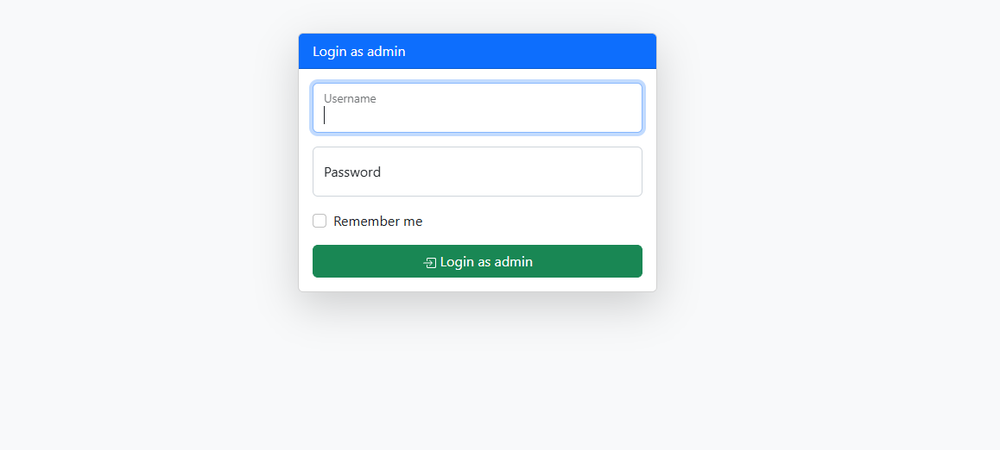
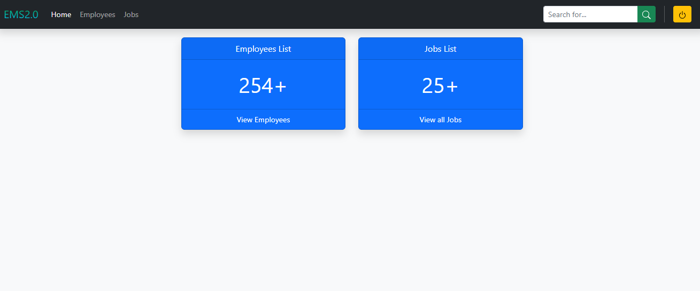
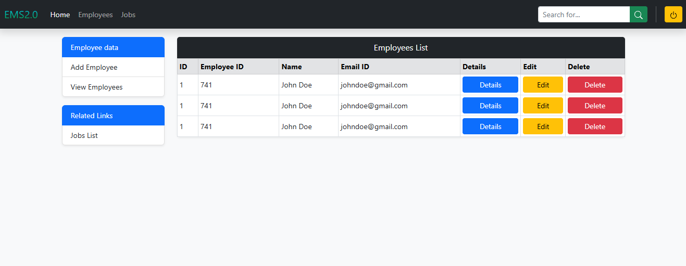
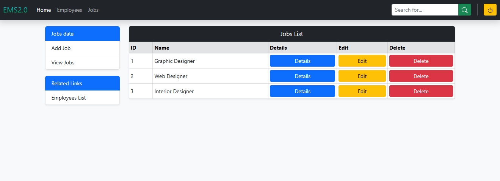
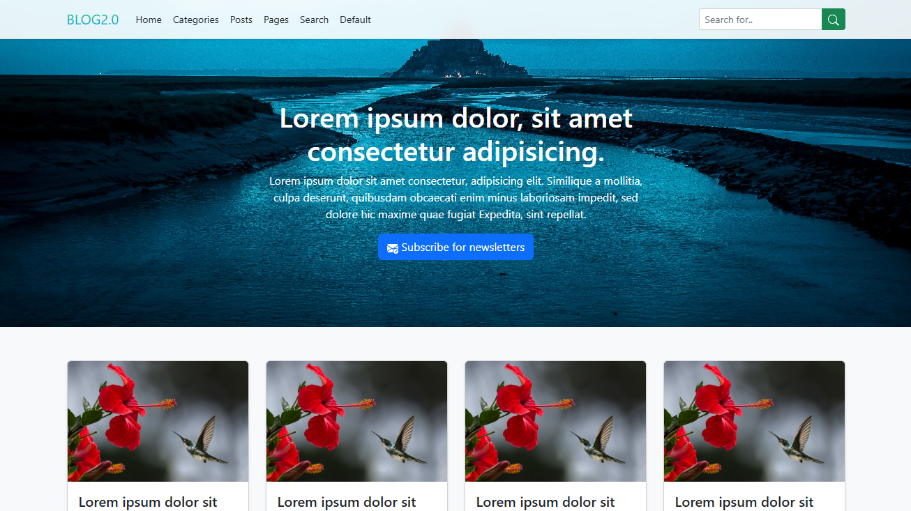
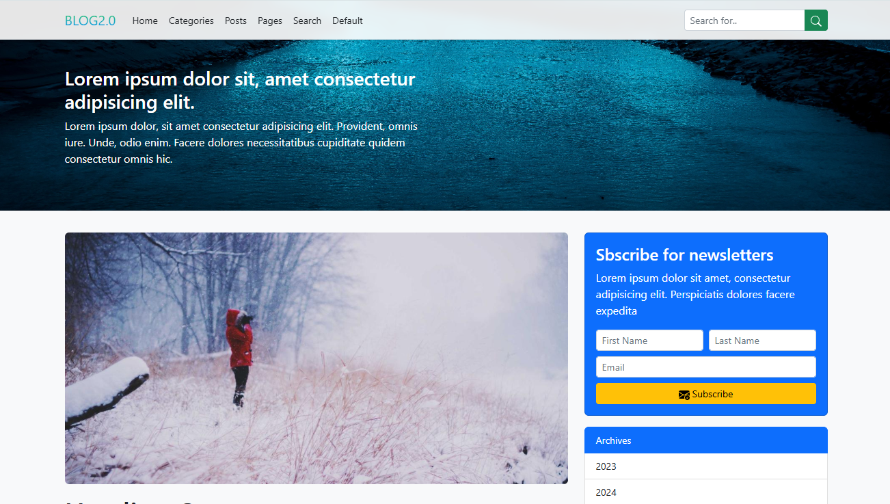
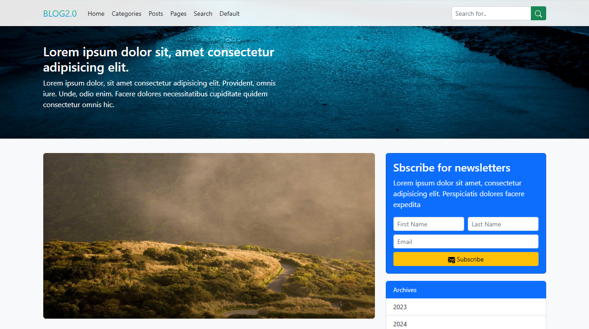
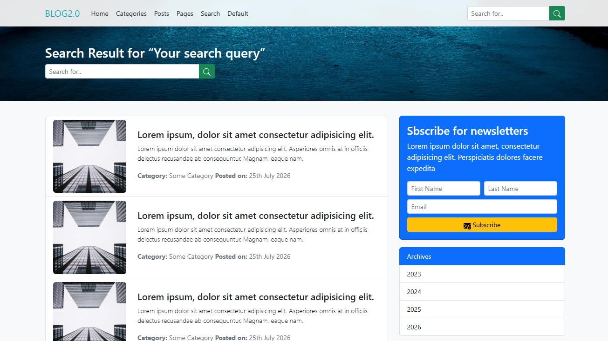

<h1 align="center">Ultimate Bootstrap</h1>

<h3 align="center">A Comprehensive Bootstrap 5 Learning Repository — From Fundamentals to Responsive Web Projects</h3>

<p align="center">
  
  
  
  
</p>

<p align="center">
  <a href="#repository-structure">Repository Structure</a> •
  <a href="#featured-projects">Featured Projects</a> •
  <a href="#learning-roadmap">Learning Roadmap</a> •
  <a href="#getting-started">Getting Started</a>
</p>

---
## Table of Contents

<details>
<summary><strong>Table of Contents</strong></summary>

- [Repository Structure](#repository-structure)
- [Overview](#overview)
- [Featured Projects](#featured-projects)
  - [1. Employee Management System](#1-employee-management-system)
  - [2. Blog App](#2-blog-app)
- [Learning Roadmap](#learning-roadmap)
  - [Section 01: Getting Started](#section-01-getting-started)
  - [Section 02: Layouts in Bootstrap](#section-02-layouts-in-bootstrap)
  - [Section 03: Contents in Bootstrap](#section-03-contents-in-bootstrap)
  - [Section 04: Forms in Bootstrap](#section-04-forms-in-bootstrap)
  - [Section 05: Components in Bootstrap 5](#section-05-components-in-bootstrap-5)
  - [Section 06: Helpers in Bootstrap 5](#section-06-helpers-in-bootstrap-5)
  - [Section 07: Utilities in Bootstrap 5](#section-07-utilities-in-bootstrap-5)
- [Tech Stack](#tech-stack)
- [Getting Started](#getting-started)
- [Running the Projects Locally](#running-the-projects-locally)
- [Learning Outcomes](#learning-outcomes)
- [Author](#author)

</details>
---

## Repository Structure

<details>
<summary><strong>Click to View Repository Structure</strong></summary>

```text
Ultimate-Bootstrap/
│
├── Section 01 - Getting Started/
│   └── 01-hello-word/
│       └── index.html
│
├── Section 02 - Layouts in Bootstrap/
│   ├── 01-grid/
│   ├── 02-grid-option/
│   ├── 03-nesting-rows-coolumns/
│   ├── 04-column-verticle-alignment/
│   ├── 05-column-horizontal/
│   ├── 06-column-wrapping-breaks/
│   ├── 07-reordering-offsetting-columns/
│   ├── 08-Ex-column-ordering/
│   ├── 09-Ex-move-column-offset-method-coding/
│   ├── 10-marginn-utilities/
│   ├── 11-margin-utilities-2/
│   ├── 12-horizontal-gutters/
│   ├── 13-vertical-gutters/
│   └── 14-horizontal-vertical-gutters/
│
├── Section 03 - Contents in Bootstrap/
│   ├── 01-typography/
│   ├── 02-inline-text-elements/
│   ├── 03-abbreviation-blockquotes/
│   ├── 04-list/
│   ├── 05-images/
│   ├── 06-tables/
│   ├── 07-table-alignment-nesting-anatomy/
│   └── 08-figures/
│
├── Section 04 - Forms in Bootstrap/
│   ├── 01-form/
│   ├── 02-form-control/
│   ├── 03-check-and-radios/
│   ├── 04-range/
│   ├── 05-input-groups/
│   ├── 06-floating-labels/
│   ├── 07-form-layout/
│   ├── 08-horizontalforms/
│   ├── 09-auto-sizing-forms/
│   ├── 10-inline-forms/
│   └── 11-form-validation/
│
├── Section 05 - Componentsin Bootstrap 5/
│   ├── 001-acordions/
│   ├── 002-alerts/
│   ├── 003-dismissing-alerts/
│   ├── 004-badge/
│   ├── 005-Breadcrumb/
│   ├── 006-buttons/
│   ├── 007-button-group/
│   ├── 008-buttoon-toolbar/
│   ├── 009-button-group-alteration/
│   ├── 010-card/
│   ├── 011-card-sizing/
│   ├── 012-card-navigation/
│   ├── 013-card-images/
│   ├── 014-card-style/
│   ├── 015-carousel/
│   ├── 016-close-button/
│   ├── 017-collapse/
│   ├── 018-dropdown/
│   ├── 019-menu-items/
│   ├── 020-menu-alignment/
│   ├── 021-list-grop/
│   ├── 022-modals/
│   ├── 023-navbar/
│   ├── 024-navs-and-tabs/
│   ├── 025-offcanvas-in-depth/
│   ├── 026-pagination/
│   ├── 027-placeholders/
│   ├── 028-popovers-in-depth/
│   ├── 029-progress-bars/
│   ├── 030-scrollspy/
│   ├── 031-spinners/
│   ├── 032-toasts/
│   └── 033-tooltips-depth/
│
├── Section 06 - Helpers in Bootstrap 5/
│   ├── 01-clearfix.html
│   ├── 02-color-and-background.html
│   ├── 03-colored-links.html
│   ├── 04-link(5.3-Update).html
│   ├── 05-focus-rings(5.3-Update).html
│   ├── 06-icon-link(5.3-Update).html
│   ├── 07-ratios.html
│   ├── 08-positions.html
│   ├── 09-stacks.html
│   ├── 10-visually-hidden.html
│   ├── 11-stretched-link.html
│   ├── 12-truncation.html
│   └── 13-vertical-rule.html
│
├── Section 07 - Utilities in Bootstrap 5/
│   ├── 01-backgrounds/
│   ├── 02-borders/
│   ├── 03-text/
│   ├── 04-display-and-hidig/
│   ├── 05-flex/
│   ├── 06-responsive-float/
│   ├── 07-position/
│   ├── 08-shadow/
│   ├── 09-sizing/
│   ├── 10-gap/
│   └── 11-text-in-deep/
│
├── EMS Website/
│   ├── index.html
│   ├── dash.html
│   ├── employees-list.html
│   └── jobs-list.html
│
├── Blog App/
│   ├── img/
│   │   ├── banner.jpg
│   │   └── post-image.jpg
│   ├── index.html
│   ├── default.html
│   ├── page.html
│   ├── posts.html
│   ├── search.html
│   └── style.css
│
├── screenshots/
│   ├── ems-login.png
│   ├── ems-dashboard.png
│   ├── ems-employees.png
│   ├── ems-jobs.png
│   ├── blog-homepage.png
│   ├── blog-posts.png
│   ├── blog-article.png
│   └── blog-search.png
│
└── README.md
```
</details>
---

## Overview

**Ultimate Bootstrap** is a hands-on learning repository focused on mastering Bootstrap 5 and building modern, responsive web interfaces.

This repository is organized into seven structured learning sections, covering everything from fundamental Bootstrap concepts to advanced components, helpers, and utility classes.

Alongside the individual practice examples, it includes two complete front-end projects that demonstrate the practical application of Bootstrap:

- **Employee Management System (EMS)**
- **Blog App**

Each section contains individual examples and exercises designed to explore Bootstrap features through practical implementation.

## Featured Projects

### 1. Employee Management System (EMS)

**A Bootstrap-Based Employee Management Dashboard and Interface**

<kbd>Bootstrap 5</kbd> <kbd>HTML5</kbd> <kbd>Responsive UI</kbd>

A front-end Employee Management System interface designed using Bootstrap 5. The project demonstrates an administrative dashboard with employee-related information, job listings, and management interfaces.

**Live Demo:** [View Employee Management System](https://ems-website-blond.vercel.app/)

**Source Code:** [`EMS Website`](./EMS%20Website/)

**Key Features**

- Admin login interface
- Responsive navigation bar
- Administrative dashboard
- Employee summary and listing
- Employee details interface
- Add, edit, and delete employee modal interfaces
- Job listing interface
- Bootstrap forms, cards, tables, and modals

**Project Pages**

| Page | File |
|---|---|
| Admin Login | `index.html` |
| Dashboard | `dash.html` |
| Employees List | `employees-list.html` |
| Jobs List | `jobs-list.html` |

**Screenshots**

**Login Page**



**Dashboard**



**Employee Management**



**Jobs List**



---

### 2. Blog App

**A Responsive Multi-Page Blog Website Built with Bootstrap 5**

<kbd>Bootstrap 5</kbd> <kbd>HTML5</kbd> <kbd>CSS3</kbd> <kbd>Responsive Design</kbd>

A multi-page blog website interface developed with Bootstrap 5, featuring structured content layouts, navigation, blog post listings, article pages, and search-related interfaces.

**Live Demo:** [View Blog App](https://blog-app-delta-hazel.vercel.app/)

**Source Code:** [`Blog App`](./Blog%20App/)

**Key Features**

- Responsive navigation bar
- Blog homepage layout
- Blog post listing
- Individual article page
- Search results interface
- Category-style content layout
- Newsletter subscription form interface
- Custom images and styling
- Responsive Bootstrap grid and components

**Project Pages**

| Page | File |
|---|---|
| Homepage | `index.html` |
| Default / Category Layout | `default.html` |
| Article Page | `page.html` |
| Posts Page | `posts.html` |
| Search Page | `search.html` |

**Screenshots**

**Homepage**



**Posts Page**



**Article Page**



**Search Page**



---

## Learning Roadmap

### Section 01: Getting Started

Introduction to Bootstrap and the initial development setup.

**Topics Covered:**
- Introduction to Bootstrap
- Getting started with Bootstrap
- Basic HTML structure using Bootstrap
- First Bootstrap example

**Folder:** `Section 01 - Getting Started/`

### Section 02: Layouts in Bootstrap

Understanding Bootstrap's grid system and responsive layout techniques.

**Topics Covered:**
- Grid system
- Grid options and breakpoints
- Nesting rows and columns
- Vertical column alignment
- Horizontal column alignment
- Column wrapping and breaks
- Reordering and offsetting columns
- Column ordering
- Moving columns using offset utilities
- Margin utilities
- Horizontal gutters
- Vertical gutters
- Combined horizontal and vertical gutters

**Folder:** `Section 02 - Layouts in Bootstrap/`

### Section 03: Contents in Bootstrap

Exploring Bootstrap's content styling and presentation features.

**Topics Covered:**
- Typography
- Inline text elements
- Abbreviations and blockquotes
- Lists
- Images
- Tables
- Table styling and variations
- Table alignment, nesting, and anatomy
- Figures

**Folder:** `Section 03 - Contents in Bootstrap/`

### Section 04: Forms in Bootstrap

Creating and styling responsive forms with Bootstrap form controls and utilities.

**Topics Covered:**
- Basic forms
- Form controls
- Select elements and datalists
- Checkboxes and radio buttons
- Range inputs
- Input groups
- Floating labels
- Form layouts
- Horizontal forms
- Auto-sizing forms
- Inline forms
- Form validation

**Folder:** `Section 04 - Forms in Bootstrap/`

### Section 05: Components in Bootstrap 5

Exploring Bootstrap's built-in components for creating interactive and feature-rich web interfaces.

**Topics Covered:**
- Accordions
- Alerts and dismissible alerts
- Badges
- Breadcrumbs
- Buttons
- Button groups and toolbars
- Cards and card variations
- Carousels
- Close buttons
- Collapse
- Dropdowns and menu alignment
- List groups
- Modals
- Navigation bars
- Navs and tabs
- Offcanvas
- Pagination
- Placeholders
- Popovers
- Progress bars
- Scrollspy
- Spinners
- Toasts
- Tooltips

**Folder:** `Section 05 - Componentsin Bootstrap 5/`

### Section 06: Helpers in Bootstrap 5

Learning Bootstrap helper classes for common interface and layout requirements.

**Topics Covered:**
- Clearfix
- Color and background helpers
- Colored links
- Link helpers
- Focus rings
- Icon links
- Aspect ratios
- Positioning helpers
- Stacks
- Visually hidden elements
- Stretched links
- Text truncation
- Vertical rules

**Folder:** `Section 06 - Helpers in Bootstrap 5/`

### Section 07: Utilities in Bootstrap 5

Working with Bootstrap utility classes for flexible styling and responsive interface development.

**Topics Covered:**
- Background utilities
- Border utilities
- Text utilities
- Display utilities
- Hiding elements
- Flexbox utilities
- Responsive floats
- Position utilities
- Shadow utilities
- Sizing utilities
- Gap utilities
- Font size and font weight
- Text transformation and decoration
- Text wrapping and breaking
- Line height
- Vertical alignment
- Visibility
- Z-index

**Folder:** `Section 07 - Utilities in Bootstrap 5/`

---

## Tech Stack

| Technology | Purpose |
|---|---|
| HTML5 | Web structure and content |
| CSS3 | Custom styling and visual presentation |
| Bootstrap 5 | Responsive layouts, components, and utilities |
| JavaScript | Interactive Bootstrap components |
| Bootstrap Icons | Interface icons |
| Vercel | Project deployment and hosting |

---

## Getting Started

Follow these steps to explore the repository on your local machine.

### Prerequisites

Make sure you have the following installed:

- Git
- Visual Studio Code
- Live Server Extension
- A modern web browser

### Clone the Repository

```bash
git clone https://github.com/mhsakibb/Ultimate-Bootstrap.git
```

### Navigate to the Project Directory

```bash
cd Ultimate-Bootstrap
```

### Open in Visual Studio Code

```bash
code .
```

---

## Running the Projects Locally

The repository contains standalone HTML files, so you can use the Live Server extension to run the examples and projects locally.

### Run a Bootstrap Practice Example

1. Open the desired section folder.
2. Select a lesson folder.
3. Open its HTML file.
4. Right-click and select **Open with Live Server**.

### Run the Employee Management System

Open:

```text
EMS Website/index.html
```

Run the file using Live Server.

### Run the Blog App

Open:

```text
Blog App/index.html
```

Run the file using Live Server.

**Note:** Bootstrap CSS and JavaScript are included through CDN links. An active internet connection is required to load these external resources.

---

## Learning Outcomes

Through this repository and its practical projects, I have gained hands-on experience in:

- Understanding and implementing Bootstrap 5.
- Creating responsive layouts using the Bootstrap grid system.
- Working with Bootstrap components and utility classes.
- Designing structured and responsive forms.
- Building navigation bars and dashboard interfaces.
- Implementing modals, cards, tables, alerts, and other UI components.
- Organizing front-end projects into structured folders and files.
- Applying Bootstrap concepts to multi-page website development.

---

## Author

**MH Sakib**

Computer Science and Engineering Student | Front-End Development Enthusiast

<p>
  <a href="https://github.com/mhsakibb">
    
  </a>
</p>

**Repository:** [Ultimate Bootstrap](https://github.com/mhsakibb/Ultimate-Bootstrap)

---

<p align="center">
  <strong>Learning by Building. Improving with Every Project.</strong>
</p>