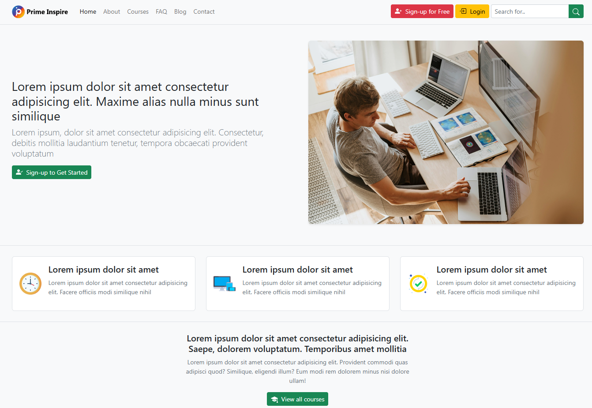
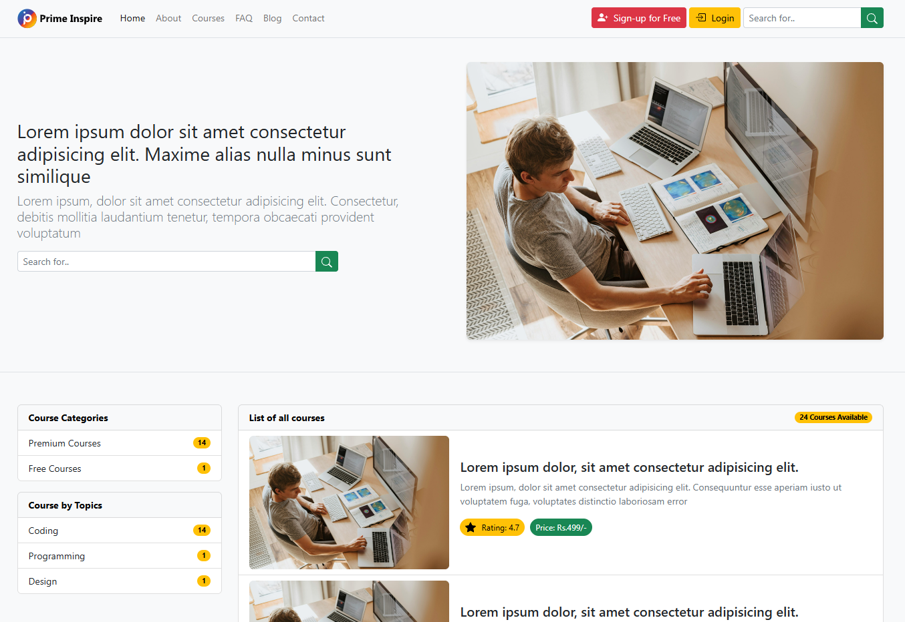
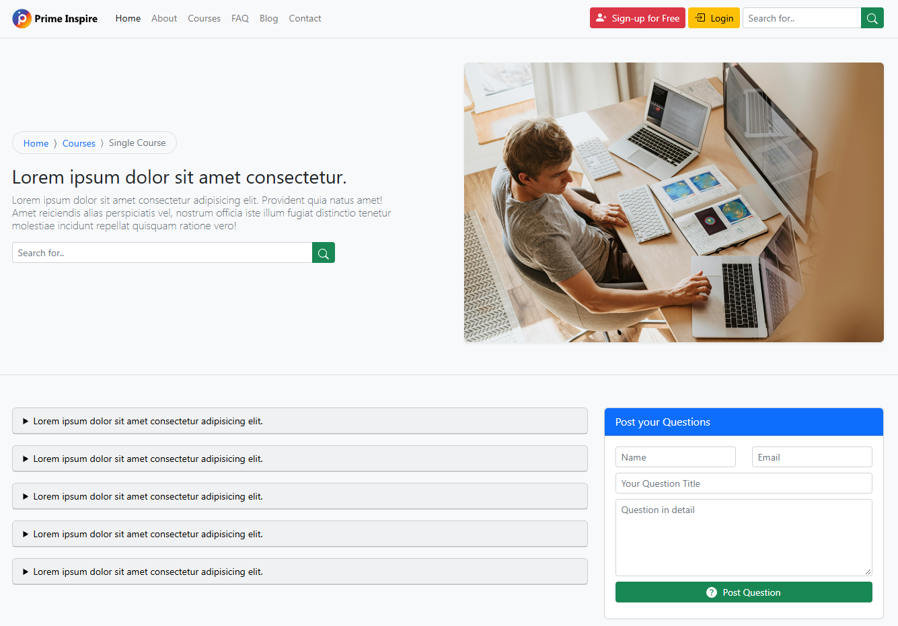
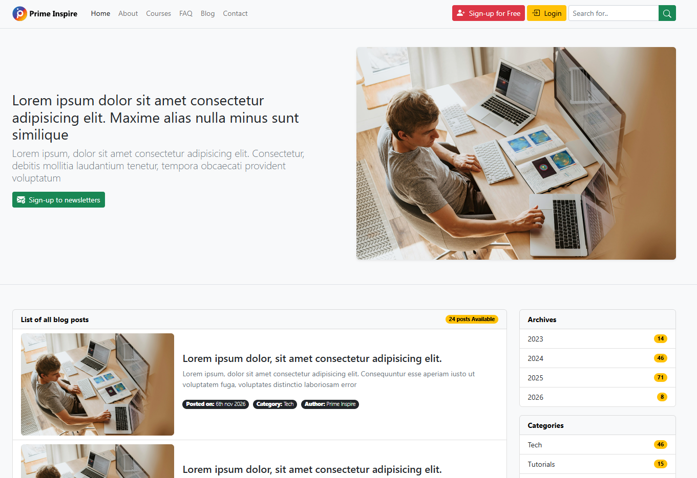
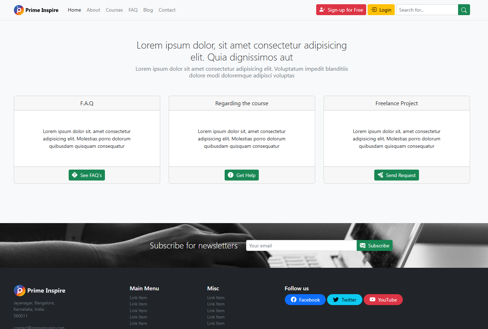

<div align="center">

# Ultimate Bootstrap

### A Comprehensive Bootstrap 5 Learning Repository — From Fundamentals to Responsive Web Projects

A hands-on learning repository covering Bootstrap 5 fundamentals, layouts, content styling, forms, components, helpers, and utilities, along with three practical front-end website projects.

<br>


<br>

**[View Repository](https://github.com/mhsakibb/Ultimate-Bootstrap)**

</div>

---

## Table of Contents

<details>
<summary><strong>Click to Expand / Collapse Table of Contents</strong></summary>

- [Overview](#overview)
- [Repository Highlights](#repository-highlights)
- [Tech Stack](#tech-stack)
- [Featured Projects](#featured-projects)
  - [1. Real World Education App](#1-real-world-education-app)
  - [2. Blog App](#2-blog-app)
  - [3. Employee Management System](#3-employee-management-system)
- [Learning Roadmap](#learning-roadmap)
  - [Section 01: Getting Started](#section-01-getting-started)
  - [Section 02: Layouts in Bootstrap](#section-02-layouts-in-bootstrap)
  - [Section 03: Contents in Bootstrap](#section-03-contents-in-bootstrap)
  - [Section 04: Forms in Bootstrap](#section-04-forms-in-bootstrap)
  - [Section 05: Components in Bootstrap 5](#section-05-components-in-bootstrap-5)
  - [Section 06: Helpers in Bootstrap 5](#section-06-helpers-in-bootstrap-5)
  - [Section 07: Utilities in Bootstrap 5](#section-07-utilities-in-bootstrap-5)
- [Getting Started](#getting-started)
- [Running the Projects Locally](#running-the-projects-locally)
- [Implementation Notes](#implementation-notes)
- [Learning Outcomes](#learning-outcomes)
- [Author](#author)

</details>

---

## Overview

**Ultimate Bootstrap** is a practical learning repository focused on understanding and applying Bootstrap 5 to modern web interface development.

The repository is organized into seven learning sections, progressing from basic Bootstrap setup to responsive layouts, content styling, forms, components, helper classes, and utility classes.

Alongside the individual lessons and exercises, the repository includes three featured front-end projects:

1. **Real World Education App** — A multi-page educational website interface.
2. **Blog App** — A responsive multi-page blog website.
3. **Employee Management System** — An administrative dashboard with employee and job management interfaces.

The projects demonstrate how Bootstrap concepts can be applied to build structured, responsive, and visually organized web interfaces.

---

## Repository Highlights

| Category | Details |
|---|---|
| Learning Sections | 7 structured sections |
| Featured Projects | 3 front-end projects |
| Framework | Bootstrap 5 |
| Markup | HTML5 |
| Styling | CSS3 |
| Interactivity | Bootstrap JavaScript components |
| Deployment | Vercel |
| Repository Hosting | GitHub |

---

## Tech Stack

The repository uses the following technologies and tools:

| Technology | Purpose |
|---|---|
| HTML5 | Building webpage structures and content |
| CSS3 | Custom styling and visual presentation |
| Bootstrap 5 | Responsive layouts, components, and utility classes |
| JavaScript | Supporting interactive interface components |
| Bootstrap JavaScript Bundle | Enabling Bootstrap interactive components |
| Vercel | Hosting and deploying the featured projects |
| Git & GitHub | Version control and source code management |

**Bootstrap Version:** The featured project pages reference Bootstrap `5.2.0-beta1` through the jsDelivr CDN. Some learning examples also cover Bootstrap 5.3 updates.

---

## Featured Projects

This repository includes three practical projects that demonstrate the application of Bootstrap 5 in different types of website interfaces.

### Project Overview

| Project | Description | Live Demo |
|---|---|---|
| Real World Education App | Multi-page educational website | [View Project](https://real-world-education-app.vercel.app/) |
| Blog App | Responsive blog website | [View Project](https://blog-app-mhsakibb.vercel.app/) |
| Employee Management System | Employee and job management dashboard interface | [View Project](https://ems-website-blond.vercel.app/) |

---

### 1. Real World Education App

**Prime Inspire — Educational Website Interface**

<kbd>Bootstrap 5</kbd> <kbd>HTML5</kbd> <kbd>CSS3</kbd> <kbd>Responsive Design</kbd>

**Live Demo:** [Real World Education App](https://real-world-education-app.vercel.app/)

**Source Code:** [`Real World Education app/`](./Real%20World%20Education%20app/)

The Real World Education App is a multi-page educational website interface developed using Bootstrap 5. The project demonstrates how to structure an education-focused website with dedicated pages for courses, articles, institutional information, and user communication.

The website uses the Prime Inspire branding and includes reusable navigation, content sections, and Bootstrap components.

#### Key Features

- Multi-page educational website structure.
- Responsive navigation bar with collapsible menu.
- Homepage with hero and feature sections.
- About page presenting the educational platform.
- Course listing interface.
- Individual course detail pages.
- Blog listing and single article layouts.
- Frequently Asked Questions page.
- Contact page with a contact modal interface.
- Search input interface.
- Newsletter subscription section and modal.
- Reusable Bootstrap grid layouts and components.
- Custom images, branding, and CSS styling.

#### Project Pages

| Page | File |
|---|---|
| Homepage | `index.html` |
| About | `about.html` |
| Courses | `courses.html` |
| Single Course | `single-course.html` |
| FAQ | `faq.html` |
| Blog | `blog.html` |
| Single Post | `single-post.html` |
| Contact | `contact.html` |

#### Project Screenshots

**Homepage**

<p align="center">
  
</p>

<p align="center">
  <em>Homepage — Main Landing Page</em>
</p>

**Courses Page**

<p align="center">
  
</p>

<p align="center">
  <em>Courses — Course Listing Interface</em>
</p>

**FAQ Page**

<p align="center">
  
</p>

<p align="center">
  <em>FAQ — Frequently Asked Questions</em>
</p>

**Blog Page**

<p align="center">
  
</p>

<p align="center">
  <em>Blog — Articles and Content Listing</em>
</p>

**Contact Page**

<p align="center">
  
</p>

<p align="center">
  <em>Contact — Contact Information and Inquiry Interface</em>
</p>

---

### 2. Blog App

**A Responsive Multi-Page Blog Website**

<kbd>Bootstrap 5</kbd> <kbd>HTML5</kbd> <kbd>CSS3</kbd> <kbd>Responsive Design</kbd>

**Live Demo:** [Blog App](https://blog-app-mhsakibb.vercel.app/)

**Source Code:** [`Blog App/`](./Blog%20App/)

The Blog App is a multi-page blog website interface built with Bootstrap 5. It demonstrates how to organize blog content into different page layouts, including a homepage, post listings, individual article views, and search results.

The project focuses on content presentation, responsive navigation, reusable layouts, and Bootstrap-based UI components.

#### Key Features

- Responsive navigation bar with collapsible menu.
- Blog homepage with featured content sections.
- Blog post listing interface.
- Individual article layout.
- Default content and category-style page layout.
- Search results page interface.
- Blog content cards and image sections.
- Newsletter subscription interface.
- Bootstrap modal for newsletter subscription.
- Responsive grid and spacing utilities.
- Custom banner, gradient styling, and CSS enhancements.

#### Project Pages

| Page | File |
|---|---|
| Homepage | `index.html` |
| Default Layout | `default.html` |
| Posts Listing | `posts.html` |
| Individual Page / Article | `page.html` |
| Search Results | `search.html` |

#### Project Screenshots

**Homepage**

<p align="center">
  
</p>

**Blog Posts**

<p align="center">
  
</p>

**Article Page**

<p align="center">
  
</p>

**Search Results**

<p align="center">
  
</p>

---

### 3. Employee Management System

**EMS — Employee and Job Management Dashboard Interface**

<kbd>Bootstrap 5</kbd> <kbd>HTML5</kbd> <kbd>CSS3</kbd> <kbd>Dashboard UI</kbd>

**Live Demo:** [Employee Management System](https://ems-website-blond.vercel.app/)

**Source Code:** [`EMS Website/`](./EMS%20Website/)

The Employee Management System is a Bootstrap-based administrative interface designed to demonstrate employee and job management workflows.

The project includes a login screen, dashboard, employee listing interface, and job listing interface. Bootstrap tables, forms, navigation components, and modal dialogs are used to organize the management views.

#### Key Features

- Login page interface.
- Administrative dashboard.
- Employee summary and listing interface.
- Job summary and listing interface.
- Employee information table.
- Job information table.
- Add employee modal interface.
- View employee details modal.
- Edit employee modal interface.
- Delete confirmation modal.
- Add job modal interface.
- View job details modal.
- Edit job modal interface.
- Delete job confirmation modal.
- Search input interfaces.
- Responsive navigation.
- Bootstrap forms, tables, cards, and modals.

#### Project Pages

| Page | File |
|---|---|
| Login Page | `index.html` |
| Dashboard | `dash.html` |
| Employees List | `employees-list.html` |
| Jobs List | `jobs-list.html` |

#### Project Screenshots

**Login Page**

<p align="center">
  
</p>

**Dashboard**

<p align="center">
  
</p>

**Employee Management**

<p align="center">
  
</p>

**Job Management**

<p align="center">
  
</p>

---

## Learning Roadmap

The repository contains seven learning sections covering the major concepts of Bootstrap 5.

### Section 01: Getting Started

**Folder:** `Section 01 - Getting Started/`

An introduction to Bootstrap and the initial setup required to start building web interfaces.

**Topics Covered:**

- Bootstrap introduction.
- Bootstrap setup and integration.
- Basic HTML page structure.
- First Bootstrap example.

### Section 02: Layouts in Bootstrap

**Folder:** `Section 02 - Layouts in Bootstrap/`

Explore Bootstrap's grid system and learn how to create flexible page layouts.

**Topics Covered:**

- Grid system.
- Grid options and breakpoints.
- Nested rows and columns.
- Vertical column alignment.
- Horizontal column alignment.
- Column wrapping and breaks.
- Reordering and offsetting columns.
- Column ordering.
- Moving columns using offset utilities.
- Margin utilities.
- Horizontal gutters.
- Vertical gutters.
- Combined horizontal and vertical gutters.

### Section 03: Contents in Bootstrap

**Folder:** `Section 03 - Contents in Bootstrap/`

Learn how to style and organize webpage content using Bootstrap's built-in content classes.

**Topics Covered:**

- Typography.
- Inline text elements.
- Abbreviations and blockquotes.
- Lists.
- Images.
- Tables.
- Table alignment and nesting.
- Table anatomy.
- Figures.

### Section 04: Forms in Bootstrap

**Folder:** `Section 04 - Forms in Bootstrap/`

Understand how to create and style responsive forms using Bootstrap form controls and utilities.

**Topics Covered:**

- Basic forms.
- Form controls.
- Checkboxes and radio buttons.
- Range inputs.
- Input groups.
- Floating labels.
- Form layouts.
- Horizontal forms.
- Auto-sizing forms.
- Inline forms.
- Form validation.

### Section 05: Components in Bootstrap 5

**Folder:** `Section 05 - Componentsin Bootstrap 5/`

Explore Bootstrap's reusable interface components and learn how to build interactive user interfaces.

**Topics Covered:**

- Accordions.
- Alerts and dismissible alerts.
- Badges.
- Breadcrumbs.
- Buttons.
- Button groups and toolbars.
- Cards and card variations.
- Carousels.
- Close buttons.
- Collapse.
- Dropdowns and menu alignment.
- List groups.
- Modals.
- Navigation bars.
- Navs and tabs.
- Offcanvas.
- Pagination.
- Placeholders.
- Popovers.
- Progress bars.
- Scrollspy.
- Spinners.
- Toasts.
- Tooltips.

### Section 06: Helpers in Bootstrap 5

**Folder:** `Section 06 - Helpers in Bootstrap 5/`

Learn how Bootstrap helper classes simplify common layout, styling, and positioning requirements.

**Topics Covered:**

- Clearfix.
- Color and background helpers.
- Colored links.
- Link helpers.
- Focus rings.
- Icon links.
- Aspect ratios.
- Positioning helpers.
- Stacks.
- Visually hidden elements.
- Stretched links.
- Text truncation.
- Vertical rules.

### Section 07: Utilities in Bootstrap 5

**Folder:** `Section 07 - Utilities in Bootstrap 5/`

Explore Bootstrap utility classes for controlling layout, spacing, typography, positioning, and responsive behavior.

**Topics Covered:**

- Background utilities.
- Border utilities.
- Text utilities.
- Display utilities.
- Hiding elements.
- Flexbox utilities.
- Responsive floats.
- Position utilities.
- Shadow utilities.
- Sizing utilities.
- Gap utilities.
- Font size and weight.
- Text transformation and decoration.
- Text wrapping and breaking.
- Line height.
- Vertical alignment.
- Visibility.
- Z-index.

---

## Repository Structure

<details>
<summary><strong>Click to Expand / Collapse Repository Structure</strong></summary>

```text
Ultimate-Bootstrap/
│
├── Section 01 - Getting Started/
│   └── 01-hello-word/
│
├── Section 02 - Layouts in Bootstrap/
│   ├── 01-grid/
│   ├── 02-grid-option/
│   ├── 03-nesting-rows-coolumns/
│   ├── 04-column-verticle-alignment/
│   ├── 05-column-horizontal/
│   ├── 06-column-wrapping-breaks/
│   ├── 07-reordering-offsetting-columns/
│   ├── 08-Ex-column-ordering/
│   ├── 09-Ex-move-column-offset-method-coding/
│   ├── 10-marginn-utilities/
│   ├── 11-margin-utilities-2/
│   ├── 12-horizontal-gutters/
│   ├── 13-vertical-gutters/
│   └── 14-horizontal-vertical-gutters/
│
├── Section 03 - Contents in Bootstrap/
│   ├── 01-typography/
│   ├── 02-inline-text-elements/
│   ├── 03-abbreviation-blockquotes/
│   ├── 04-list/
│   ├── 05-images/
│   ├── 06-tables/
│   ├── 07-table-alignment-nesting-anatomy/
│   └── 08-figures/
│
├── Section 04 - Forms in Bootstrap/
│   ├── 01-form/
│   ├── 02-form-control/
│   ├── 03-check-and-radios/
│   ├── 04-range/
│   ├── 05-input-groups/
│   ├── 06-floating-labels/
│   ├── 07-form-layout/
│   ├── 08-horizontalforms/
│   ├── 09-auto-sizing-forms/
│   ├── 10-inline-forms/
│   └── 11-form-validation/
│
├── Section 05 - Componentsin Bootstrap 5/
│   ├── 001-acordions/
│   ├── 002-alerts/
│   ├── 003-dismissing-alerts/
│   ├── 004-badge/
│   ├── 005-Breadcrumb/
│   ├── 006-buttons/
│   ├── 007-button-group/
│   ├── 008-buttoon-toolbar/
│   ├── 009-button-group-alteration/
│   ├── 010-card/
│   ├── 011-card-sizing/
│   ├── 012-card-navigation/
│   ├── 013-card-images/
│   ├── 014-card-style/
│   ├── 015-carousel/
│   ├── 016-close-button/
│   ├── 017-collapse/
│   ├── 018-dropdown/
│   ├── 019-menu-items/
│   ├── 020-menu-alignment/
│   ├── 021-list-grop/
│   ├── 022-modals/
│   ├── 023-navbar/
│   ├── 024-navs-and-tabs/
│   ├── 025-offcanvas-in-depth/
│   ├── 026-pagination/
│   ├── 027-placeholders/
│   ├── 028-popovers-in-depth/
│   ├── 029-progress-bars/
│   ├── 030-scrollspy/
│   ├── 031-spinners/
│   ├── 032-toasts/
│   └── 033-tooltips-depth/
│
├── Section 06 - Helpers in Bootstrap 5/
│   ├── 01-clearfix.html
│   ├── 02-color-and-background.html
│   ├── 03-colored-links.html
│   ├── 04-link(5.3-Update).html
│   ├── 05-focus-rings(5.3-Update).html
│   ├── 06-icon-link(5.3-Update).html
│   ├── 07-ratios.html
│   ├── 08-positions.html
│   ├── 09-stacks.html
│   ├── 10-visually-hidden.html
│   ├── 11-stretched-link.html
│   ├── 12-truncation.html
│   └── 13-vertical-rule.html
│
├── Section 07 - Utilities in Bootstrap 5/
│   ├── 01-backgrounds/
│   ├── 02-borders/
│   ├── 03-text/
│   ├── 04-display-and-hidig/
│   ├── 05-flex/
│   ├── 06-responsive-float/
│   ├── 07-position/
│   ├── 08-shadow/
│   ├── 09-sizing/
│   ├── 10-gap/
│   └── 11-text-in-deep/
│
├── Real World Education app/
│   ├── img/
│   │   ├── Prime-Inspire-Logo-dark.svg
│   │   ├── Prime-Inspire-Logo.svg
│   │   ├── clock.png
│   │   ├── main-header.jpg
│   │   ├── responsive.png
│   │   ├── subscribe.jpg
│   │   └── tick.png
│   ├── about.html
│   ├── blog.html
│   ├── contact.html
│   ├── courses.html
│   ├── faq.html
│   ├── index.html
│   ├── single-course.html
│   ├── single-post.html
│   └── styles.css
│
├── Blog App/
│   ├── img/
│   │   ├── banner.jpg
│   │   └── post-image.jpg
│   ├── default.html
│   ├── index.html
│   ├── page.html
│   ├── posts.html
│   ├── search.html
│   └── style.css
│
├── EMS Website/
│   ├── dash.html
│   ├── employees-list.html
│   ├── index.html
│   └── jobs-list.html
│
├── screenshots/
│   ├── blog-article.png
│   ├── blog-homepage.png
│   ├── blog-posts.png
│   ├── blog-search.png
│   ├── ems-dashboard.png
│   ├── ems-employees.png
│   ├── ems-jobs.png
│   ├── ems-login.png
│   └── real-world-education-homepage.png  # Add this screenshot
│
└── readme.md
```

</details>

---

## Getting Started

Follow these steps to clone the repository and explore the examples locally.

### 1. Clone the Repository

```bash
git clone https://github.com/mhsakibb/Ultimate-Bootstrap.git
```

### 2. Navigate to the Project Directory

```bash
cd Ultimate-Bootstrap
```

### 3. Open the Repository in Visual Studio Code

```bash
code .
```

### 4. Explore the Learning Sections

Open any section folder and select an HTML example to explore the Bootstrap implementation.

### 5. Run an Example

Right-click the desired HTML file and select **Open with Live Server**.

---

## Running the Projects Locally

All three featured projects are organized into separate folders and contain standalone HTML files.

### Real World Education App

Open:

```text
Real World Education app/index.html
```

### Blog App

Open:

```text
Blog App/index.html
```

### Employee Management System

Open:

```text
EMS Website/index.html
```

Use the Live Server extension in Visual Studio Code to run each project locally.

**Dependency Note:** The project pages reference Bootstrap CSS and JavaScript through CDN links. An active internet connection is required to load these external resources.

---

## Implementation Notes

This repository primarily focuses on front-end development and Bootstrap-based interface implementation.

- The featured projects are static front-end website implementations.
- Bootstrap is loaded through CDN references.
- The login, search, contact, and newsletter sections represent front-end interfaces.
- Employee and job management operations are demonstrated through Bootstrap interface elements and modal layouts.
- No backend API, database, or production authentication system is included in the repository.

These distinctions describe the current implementation and do not imply functionality that has not been developed.

---

## Learning Outcomes

Through the lessons and practical projects in this repository, I have gained hands-on experience in:

- Understanding and implementing Bootstrap 5.
- Building responsive layouts using the Bootstrap grid system.
- Working with Bootstrap components and utility classes.
- Creating structured forms and content layouts.
- Designing navigation bars and dashboard interfaces.
- Using Bootstrap modals, cards, tables, alerts, and other UI components.
- Organizing multi-page front-end projects.
- Applying responsive design principles to practical website development.
- Translating individual framework concepts into complete website interfaces.

---

## Author

<div align="center">

### MH Sakib

Computer Science and Engineering Student

<br>

<a href="https://github.com/mhsakibb">
  
</a>

<a href="https://youtube.com/@mh_sakib">
  
</a>

<br>

**Repository:** [Ultimate Bootstrap](https://github.com/mhsakibb/Ultimate-Bootstrap)

</div>

---

<div align="center">

**Learning by Building. Improving with Every Project.**

</div>